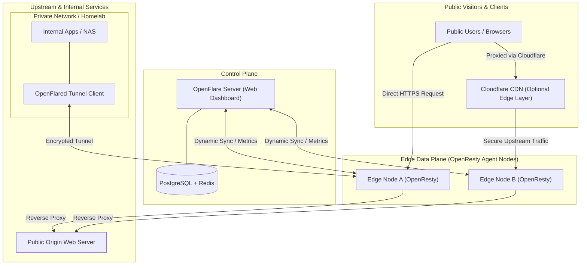
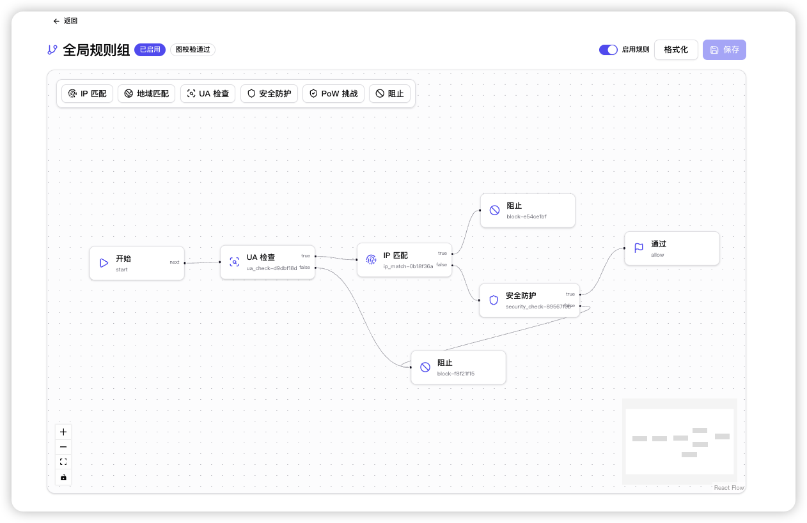
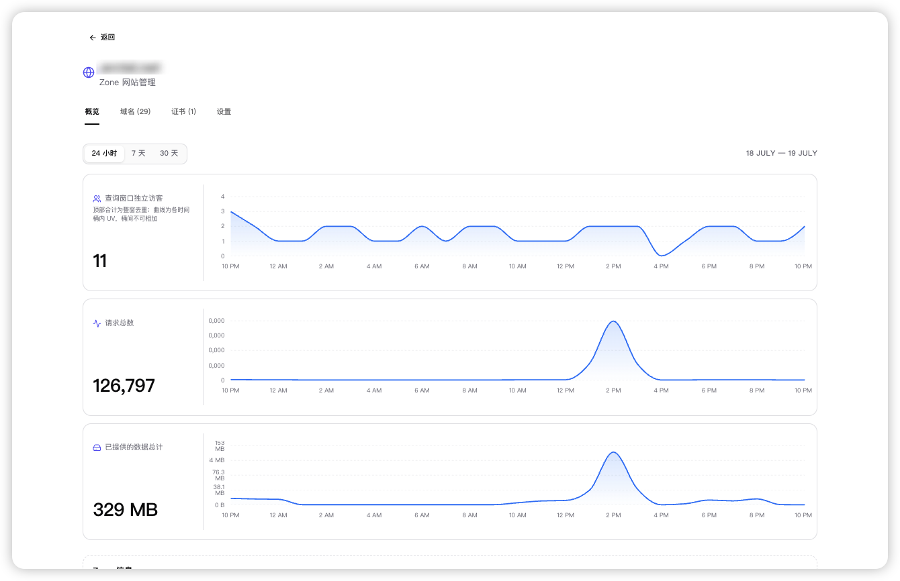

<div align="center">

# OpenFlare

**Next-Gen Distributed Reverse Proxy & Edge Security Gateway for OpenResty / Nginx**

**[English](./README.md) | [简体中文](./README.zh-CN.md)**

<p align="center">
  <a href="https://raw.githubusercontent.com/Rain-kl/OpenFlare/main/LICENSE">
    
  </a>
  <a href="https://github.com/Rain-kl/OpenFlare/releases/latest">
    
  </a>
  <a href="https://github.com/Rain-kl/OpenFlare/pkgs/container/openflare">
    
  </a>
</p>

</div>

---

## 📖 What is OpenFlare?

**OpenFlare** is a modern, open-source **distributed reverse proxy and edge security gateway platform** designed for multi-server infrastructures and edge clusters.

Rather than a simple single-host admin panel, OpenFlare empowers traditional OpenResty / Nginx nodes with **centralized cluster orchestration, dynamic zero-reload sync, line-rate edge WAF defense, and secure in-network tunneling**:

* ⚡ **Zero-Reload Dynamic Orchestration**: Centralized control plane manages any number of edge nodes. Synchronize rule diffs in milliseconds with zero Nginx reload disruptions.
* 🛡️ **Built-in Edge Security & Anti-CC (Turnstile Alternative)**: Comprehensive WAF rule engine, MaxMind GeoIP regional ACLs, and **client-side cryptographic Proof of Work (PoW) challenges** to eliminate botnets and CC attacks at line rate.
* 🚇 **Zero-Trust Tunnels (Cloudflare Tunnel Alternative)**: Securely publish private homelab and internal web services to edge proxies via lightweight `openflared` clients without public IPs or open inbound ports.
* 📦 **Pages Edge Hosting**: Host static sites and SPAs pulled directly from GitHub Releases or uploaded bundles, distributed across edge nodes with instant rollbacks and fallback routing.
* 🔒 **Automated Certificates & SSO**: Automatic multi-domain Let's Encrypt certificates via ACME and enterprise single sign-on with GitHub OAuth and standard OIDC.

---

## 🌐 Flexible Deployment: Standalone or Behind Cloudflare

OpenFlare is designed to operate seamlessly either as an independent edge gateway or in harmony with Cloudflare and public CDNs:

### 1. Standalone Edge Gateway (Private CDN)
Ideal for developers managing multi-region VPS clusters or homelabs:
* Deploy your own high-availability CDN and edge proxy cluster with 100% data and privacy ownership.
* Protect origin sites with built-in Turnstile-like PoW human challenges, dynamic WAF, and automated SSL certs without expensive enterprise CDN security plans.

### 2. Behind Cloudflare (Hardened Origin Shield)
Functions as an intelligent **origin shield and routing gateway** behind Cloudflare:
* **Leaked Real IP Protection**: If attackers bypass Cloudflare and directly hit your origin's public IP address, OpenFlare's edge WAF and PoW challenges will immediately intercept and block the attack.
* **Full Private Log & Metric Retention**: Overcomes Cloudflare Free tier limitations by retaining comprehensive, searchable request logs and operational metrics locally.
* **Unified In-Network Routing**: Ingest incoming Cloudflare traffic and dynamically route it across internal backends or private homelab services through secure tunnels.

---

## 📊 Comparison: Traditional Nginx vs NPM vs OpenFlare

| Feature | Traditional Nginx (`nginx.conf`) | Nginx Proxy Manager (NPM) | **OpenFlare** |
| :--- | :--- | :--- | :--- |
| **Cluster Architecture** | Manual per-host editing via SSH | Single node only; no cluster sync | **Native Distributed Control Plane + Edge Agents** |
| **Configuration Sync** | Requires `nginx -s reload` (connection churn) | Reloads on every change | **Shared memory dynamic sync (Zero-Reload)** |
| **Anti-CC / Bot Protection** | Basic `limit_req` rate limiting only | Not supported | **Built-in Turnstile-like PoW Client Challenge** |
| **In-Network Tunnels** | Requires separate third-party tools (frp) | Not supported | **Built-in OpenFlared Tunnels (Zero inbound ports)** |
| **WAF & Threat Defense** | Requires manual ModSecurity compilation | Basic exploit rules only | **Dynamic WAF, GeoIP, IP list checksum sync** |
| **Static Pages Hosting** | Manual directory copying and setup | Static file proxying only | **Automated GitHub Release deployment & rollbacks** |
| **Works with Cloudflare** | Manual `set_real_ip_from` list maintenance | Complex proxy header tuning | **Native real IP restoration, ideal origin shield** |

---

## 🏗️ Architecture



---

## 🖥️ UI Preview

### Dashboard Overview


### Edge WAF & Access Rules


### Domain & Traffic Analytics


---

## ⚡ Quick Start

### 1. Launch OpenFlare Server

Deploy the control plane using `docker-compose`:

```bash
# Download environment template
curl -o .env.example https://raw.githubusercontent.com/Rain-kl/OpenFlare/refs/heads/main/.env.example
cp .env.example .env
```

```yaml
services:
  openflare:
    image: ghcr.io/rain-kl/openflare:latest
    restart: unless-stopped
    env_file: .env
    environment:
      TZ: ${TZ:-Asia/Shanghai}
    ports:
      - "3000:3000"
    volumes:
      - openflare_uploads:/app/uploads
    depends_on:
      postgres:
        condition: service_healthy
      redis:
        condition: service_healthy

  postgres:
    image: postgres:17-alpine
    restart: unless-stopped
    environment:
      POSTGRES_DB: ${DB_NAME:-openflare}
      POSTGRES_USER: ${DB_USERNAME:-openflare}
      POSTGRES_PASSWORD: ${DB_PASSWORD:-replace-with-strong-password}
    volumes:
      - openflare_postgres_data:/var/lib/postgresql/data
    healthcheck:
      test: ["CMD-SHELL", "pg_isready -U ${DB_USERNAME:-openflare} -d ${DB_NAME:-openflare}"]
      interval: 10s
      timeout: 5s
      retries: 5

  redis:
    image: valkey/valkey:8.0-alpine
    restart: unless-stopped
    command: ["valkey-server", "--appendonly", "yes"]
    volumes:
      - openflare_redis_data:/data
    healthcheck:
      test: ["CMD", "valkey-cli", "ping"]
      interval: 10s
      timeout: 5s
      retries: 5
      start_period: 5s

volumes:
  openflare_uploads:
  openflare_postgres_data:
  openflare_redis_data:
```

* **Dashboard URL**: `http://localhost:3000`
* **Default Credentials**: `admin` / `12345678`

> [!WARNING]
> Change the default password `12345678` immediately upon first login.  
> The BETA version is in active development and testing; avoid using it in mission-critical production environments without regular backups.

### 2. Connect Edge Agent Node

Run the Agent container on any edge server (ensure ports 80/443 are open):

```bash
docker pull ghcr.io/rain-kl/openflare-agent:latest
docker run -d --name openflare-agent --restart unless-stopped \
  -p 80:80 -p 443:443/tcp -p 443:443/udp \
  -v openflare-agent-pages:/data/var/lib/openflare/pages \
  -e OPENFLARE_SERVER_URL=http://<YOUR_SERVER_IP>:3000 \
  -e OPENFLARE_AGENT_TOKEN=<YOUR_AGENT_TOKEN> \
  ghcr.io/rain-kl/openflare-agent:latest
```
*(Copy the node token directly from Node Management in the dashboard)*

## Cordis / Wavelet upstream

OpenFlare is built on Wavelet Cordis. After cloning, enable `merge=ours` from `.gitattributes` so `git merge wavelet/main` keeps OpenFlare-owned paths:

```bash
git config include.path ../.gitconfig
# worktree-safe:
git config include.path "$(git rev-parse --show-toplevel)/.gitconfig"
```

`docker compose` uses `docker-compose.yaml`. `docker-compose.wavelet.yml` is the upstream Wavelet stack and is not the product default. Image publishes go through `.github/workflows/build-image-openflare*.yml`; the Wavelet `build-image.yml` is isolated.

## Open Source License

This project is licensed under the [Apache License 2.0](./LICENSE).

## ⭐ Star History

<a href="https://www.star-history.com/?repos=Rain-kl%2FOpenFlare&type=date&legend=bottom-right">
 <picture>
   <source media="(prefers-color-scheme: dark)" srcset="https://api.star-history.com/chart?repos=Rain-kl/OpenFlare&type=date&theme=dark&legend=top-left" />
   <source media="(prefers-color-scheme: light)" srcset="https://api.star-history.com/chart?repos=Rain-kl/OpenFlare&type=date&legend=top-left" />
   
 </picture>
</a>
