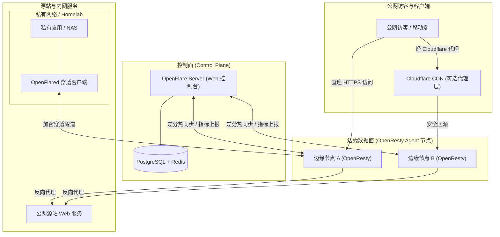

<div align="center">

# OpenFlare

**新一代分布式反向代理与边缘安全网关**  
*Next-Gen Distributed Reverse Proxy & Edge Gateway for OpenResty / Nginx*

**[简体中文](./README.zh-CN.md) | [English](./README.md)**

<p align="center">
  <a href="https://raw.githubusercontent.com/Rain-kl/OpenFlare/main/LICENSE">
    
  </a>
  <a href="https://github.com/Rain-kl/OpenFlare/releases/latest">
    
  </a>
  <a href="https://github.com/Rain-kl/OpenFlare/pkgs/container/openflare">
    
  </a>
</p>

</div>

---

## 📖 什么是 OpenFlare？

**OpenFlare** 是一套面向多服务器与分布式集群的**新一代开源反向代理与边缘安全网关平台**。

它并非简单的单机管理面板，而是将传统的 OpenResty / Nginx 升级为具备**多节点集群化编排、动态热更新、边缘 WAF 防护以及内网穿透能力**的现代化边缘网络基础设施：

* ⚡ **告别手写配置与 Reload 抖动**：单一控制面板管理任意数量的边缘节点，配置差分毫秒级热同步（Zero-Reload），业务流量平滑无感。
* 🛡️ **开箱即用的边缘安全防御**：内置 WAF 规则引擎、国家级 GeoIP 访问控制，以及**类似 Cloudflare Turnstile 的客户端密码学 PoW 防 CC 人机验证（5 秒盾）**，在边缘秒级阻断僵尸网络。
* 🚇 **原生安全内网穿透（Tunnels）**：无需公网 IP 和复杂路由器端口映射，通过轻量级 `openflared` 客户端打通加密隧道，安全将内网 Web 服务接入边缘网关并享受全套安全防护。
* 📦 **静态 Pages 边缘托管**：支持从 GitHub Release 产物或直传静态包全自动部署至各边缘节点本地分发，支持多版本回滚与 SPA 路由。
* 🔒 **自动化证书与统一认证**：ACME 协议全自动申请与续期 Let's Encrypt 多域名证书，支持 GitHub OAuth 和标准 OIDC 企业单点登录。

---

## 🌐 灵活的部署模式：独立自建 vs 协同 Cloudflare

OpenFlare 既可以作为独立的边缘网关使用，也可以与 Cloudflare 等公网 CDN 完美协作互补：

### 1. 独立自建模式 (Standalone Edge Gateway)
适用于多台 VPS、跨地域云服务器或 Homelab：
* 自主搭建私有 CDN 与反向代理集群，数据和流量 100% 本地掌控。
* 拥有完整的边缘防 CC 人机验证、自建 SSL 证书管理与内网穿透能力，无需采购昂贵的商业安全套餐。

### 2. Cloudflare 源站防护盾模式 (Behind Cloudflare / Origin Shield)
作为 Cloudflare 背后坚固的**源站集群网关**：
* **防范源站真实 IP 泄露**：即使攻击者通过历史解析或漏洞绕过 Cloudflare 直连你的源站真实 IP，OpenFlare 边缘的 WAF 与 PoW 人机挑战仍会在第一时间将其阻断。
* **全量私有访问日志沉淀**：弥补商业 CDN 免费版日志保留极短、明细不足的痛点，全量审计请求日志与监控指标。
* **统一内网与跨服路由**：由 OpenFlare 统一承接来自 Cloudflare 的流量，智能分发至源站多服务或内网穿透应用。

---

## 📊 横向对比：传统 Nginx vs Nginx Proxy Manager vs OpenFlare

| 维度 | 传统 Nginx (`nginx.conf`) | Nginx Proxy Manager (NPM) | **OpenFlare** |
| :--- | :--- | :--- | :--- |
| **集群架构** | 每台机器独立维护，频繁 SSH | 仅支持单机，无法多节点集群协同 | **原生分布式控制面 + 边缘 Agent 集群** |
| **配置生效方式** | 每次需 `nginx -s reload`，连接可能抖动 | 频繁 Reload | **共享内存/差分热同步，Zero-Reload** |
| **防 CC / 爬虫人机验证** | 仅支持简单的 `limit_req` 频率限制 | 不支持 | **内置类似 Turnstile 的 PoW 客户端挑战** |
| **内网穿透 (Tunnels)** | 需繁琐集成第三方程式 (如 frp) | 不支持 | **内置 OpenFlared 穿透隧道，开箱即用** |
| **WAF 与安全防护** | 需复杂编译配置 ModSecurity | 仅基础 Exploits 规则 | **动态 WAF、国家级 GeoIP、IP 组差分准入** |
| **静态 Pages 托管** | 手动上传并配置静态目录 | 仅静态文件代理 | **自动化拉取 GitHub Release，版本回滚** |
| **配合 Cloudflare** | 手动配置 `set_real_ip_from` 极其繁琐 | 需繁琐设置代理头部 | **原生还原真实 IP，完美充当源站护盾** |

---

## 🏗️ 架构拓扑



---

## 🖥️ 界面预览

### 仪表盘与实时观测


### 边缘 WAF 与访问控制


### 域名与流量分析


---

## ⚡ 快速开始

### 1. 启动 Server 控制端

使用 `docker-compose` 快速启动控制面：

```bash
# 获取环境变量模板
curl -o .env.example https://raw.githubusercontent.com/Rain-kl/OpenFlare/refs/heads/main/.env.example
cp .env.example .env
```

```yaml
services:
  openflare:
    image: ghcr.io/rain-kl/openflare:latest
    restart: unless-stopped
    env_file: .env
    environment:
      TZ: ${TZ:-Asia/Shanghai}
    ports:
      - "3000:3000"
    volumes:
      - openflare_uploads:/app/uploads
    depends_on:
      postgres:
        condition: service_healthy
      redis:
        condition: service_healthy

  postgres:
    image: postgres:17-alpine
    restart: unless-stopped
    environment:
      POSTGRES_DB: ${DB_NAME:-openflare}
      POSTGRES_USER: ${DB_USERNAME:-openflare}
      POSTGRES_PASSWORD: ${DB_PASSWORD:-replace-with-strong-password}
    volumes:
      - openflare_postgres_data:/var/lib/postgresql/data
    healthcheck:
      test: ["CMD-SHELL", "pg_isready -U ${DB_USERNAME:-openflare} -d ${DB_NAME:-openflare}"]
      interval: 10s
      timeout: 5s
      retries: 5

  redis:
    image: valkey/valkey:8.0-alpine
    restart: unless-stopped
    command: ["valkey-server", "--appendonly", "yes"]
    volumes:
      - openflare_redis_data:/data
    healthcheck:
      test: ["CMD", "valkey-cli", "ping"]
      interval: 10s
      timeout: 5s
      retries: 5
      start_period: 5s

volumes:
  openflare_uploads:
  openflare_postgres_data:
  openflare_redis_data:
```

* **访问控制台**：`http://localhost:3000`
* **默认账号密码**：`admin` / `12345678`

> [!WARNING]
> 初次登录后，请务必在后台第一时间修改默认密码 `12345678`。  
> BETA 版本处于开发与测试阶段，生产环境请提前做好数据备份。

### 2. 部署边缘 Agent 节点

在任意作为边缘代理的服务器上执行（需开放 80/443 端口）：

```bash
docker pull ghcr.io/rain-kl/openflare-agent:latest
docker run -d --name openflare-agent --restart unless-stopped \
  -p 80:80 -p 443:443/tcp -p 443:443/udp \
  -v openflare-agent-pages:/data/var/lib/openflare/pages \
  -e OPENFLARE_SERVER_URL=http://<YOUR_SERVER_IP>:3000 \
  -e OPENFLARE_AGENT_TOKEN=<YOUR_AGENT_TOKEN> \
  ghcr.io/rain-kl/openflare-agent:latest
```
*(Token 可在管理后台的「节点管理 -> 详情 -> 节点信息」中直接一键生成与复制)*

## Cordis / Wavelet 上游

OpenFlare 构建在 Wavelet Cordis 之上。克隆后请启用 `.gitattributes` 中的 `merge=ours`，这样 `git merge wavelet/main` 会保留 OpenFlare 自有路径：

```bash
git config include.path ../.gitconfig
# worktree 安全写法：
git config include.path "$(git rev-parse --show-toplevel)/.gitconfig"
```

`docker compose` 使用 `docker-compose.yaml`。`docker-compose.wavelet.yml` 是上游 Wavelet 编排，不是本产品的默认栈。镜像发布走 `.github/workflows/build-image-openflare*.yml`；Wavelet 的 `build-image.yml` 已隔离。

## 开源协议

## 📚 官方文档

完整配置与进阶部署详见官方文档：**[https://openflare.fyrn.link](https://openflare.fyrn.link)**

* [快速入门指南](https://openflare.fyrn.link/guide/quick-start)
* [生产部署与架构说明](https://openflare.fyrn.link/deployment/deployment)
* [配置项详细参考](https://openflare.fyrn.link/reference/configuration)
* [系统底层设计](https://openflare.fyrn.link/design/)

<details>
<summary><b>🔍 查看各组件最低与推荐硬件配置要求</b></summary>

| 组件 | 最低硬件配置 | 推荐硬件配置 | 说明 |
| :--- | :--- | :--- | :--- |
| **Server 控制面** | 1 核 CPU / 2 GB 内存 / 20 GB 磁盘 | 2 核 CPU / 4 GB 内存 / 50 GB+ 磁盘 | 根据访问日志存储时长和吞吐量灵活规划 |
| **Agent 数据面** | 1 核 CPU / 512 MB 内存 / 2 GB 磁盘 | 2 核 CPU / 2 GB 内存 / 10 GB+ 磁盘 | 取决于并发代理量与 WAF 规则量 |
| **Relay 中继节点** | 1 核 CPU / 1 GB 内存 / 5 GB 磁盘 | 2 核 CPU / 2 GB 内存 / 20 GB 磁盘 | 主要受网络带宽与并发吞吐限制 |
| **OpenFlared 客户端** | 1 核 CPU / 256 MB 内存 / 1 GB 磁盘 | 1 核 CPU / 512 MB 内存 / 5 GB 磁盘 | 极低内存占用，保证网络连接畅通即可 |

</details>

---

## ⚖️ 商标免责声明 (Trademark Disclaimer)

OpenFlare is an independent, community-driven open-source project. It is not affiliated with, endorsed by, or sponsored by Cloudflare, Inc. Cloudflare and related trademarks are the property of their respective owners.

OpenFlare 是一个由社区驱动的独立开源项目，与 Cloudflare, Inc. 无任何附属、认可或赞助关系。Cloudflare 及其相关商标均为其各自持有者的财产。

---

## 📄 开源协议

本项目基于 [Apache License 2.0](./LICENSE) 协议开源。

## ⭐ Star History

<a href="https://www.star-history.com/?repos=Rain-kl%2FOpenFlare&type=date&legend=bottom-right">
 <picture>
   <source media="(prefers-color-scheme: dark)" srcset="https://api.star-history.com/chart?repos=Rain-kl/OpenFlare&type=date&theme=dark&legend=top-left" />
   <source media="(prefers-color-scheme: light)" srcset="https://api.star-history.com/chart?repos=Rain-kl/OpenFlare&type=date&legend=top-left" />
   
 </picture>
</a>
