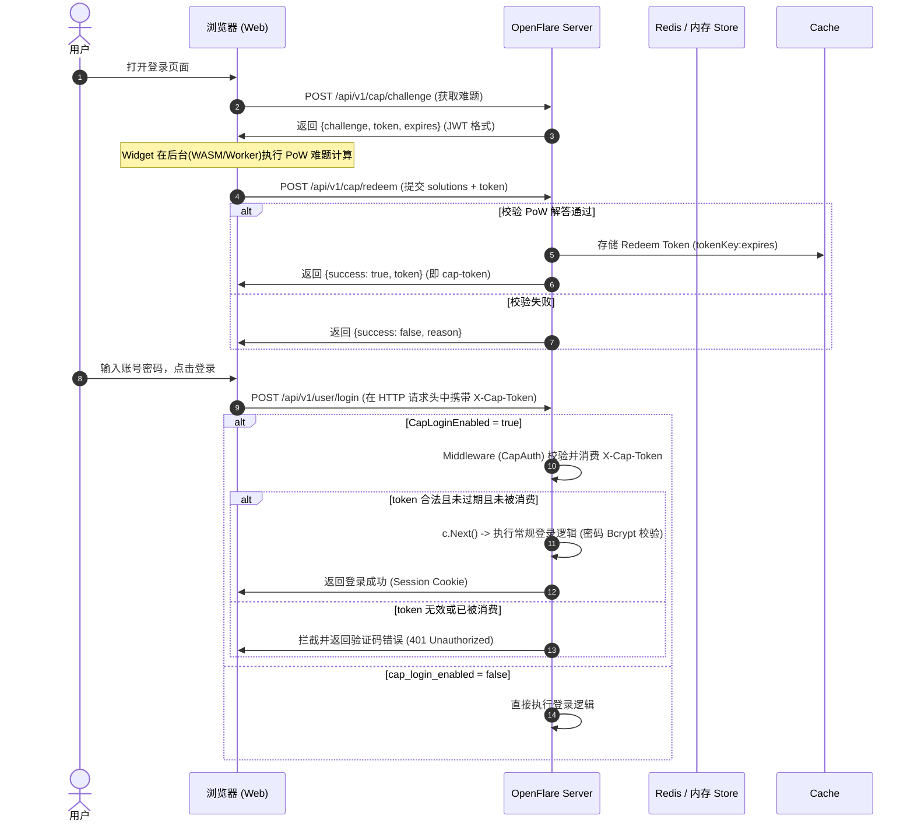

# 登录验证码设计 (Cap PoW 集成)

OpenFlare 控制面在用户登录端点集成开源工作量证明（PoW）人机验证组件 Cap，由浏览器后台计算 SHA-256 难题换取一次性凭证，在不依赖第三方图像验证码 API 的前提下防范针对 `admin` 等管理员账户的暴力破解与撞库请求。

---

## 1. 产品边界与模块分工

* **配置开关**：管理员可通过系统设置项 `cap_login_enabled` 动态开启或关闭登录验证码校验。
* **控制面后端（`internal/apps/cap/`、`pkg/cap/`）**：
  * `POST /api/cap/challenge`：公开接口，签发带过期时间的难题 JWT（默认 `scope = "login"`）与难度参数 `{ c, s, d }`；
  * `POST /api/cap/redeem`：校验解答与难题 JWT 签名，核销难题并向前端颁发一次性凭证 `token`（有效期写入 Redis 或内存 `Store`）；
  * `POST /api/v1/user/login`：挂载 `cap.VerifyMiddleware(mgr, "login")` 中间件，当开启验证时读取请求头 `X-Cap-Token` 并执行单次消费校验，无效或已消费则拦截返回 `401 Unauthorized`。
* **前端登录页**：按配置状态挂载 `cap-widget` Web Component 在 Worker 中无感求解，并在提交登录表单时附加 `X-Cap-Token` 请求头。

---

## 2. 验证流与防重放机制

### 2.1 模块分工
1. **Frontend (前端)**：
   * 在登录页面引入 `cap-widget`（React 19 自定义元素）。
   * 提交表单时，伴随提交由 Widget 求解出并得到的 `cap-token`。
2. **Server (控制面后端)**：
   * 暴露 `POST /api/v1/cap/challenge` 接口，为客户端分发 PoW 难题和签名的 JWT Token。
   * 暴露 `POST /api/v1/cap/redeem` 接口，校验客户端提交的 PoW 解答并核发带有失效时间的登录凭证（Redeem Token）。
   * 将 Redeem Token 与对应过期时间保存在内存缓存/Redis 缓存中。
   * 在 `POST /api/v1/user/login` 接口中，若启用了验证码保护，先校验并消耗（单次失效）对应的 `cap-token`。

### 2.2 验证流时序图


### 安全机制说明

## 3. 核心接口与数据模型

### 3.1 接口定义

#### 1. 获取难题 (GET/POST /api/v1/cap/challenge)
* **请求方式**：`POST`
* **接口权限**：公开
* **响应负载**（统一 API 信封，`data` 为业务载荷）：
  ```json
  {
    "error_msg": "",
    "data": {
      "challenge": {
        "c": 1,
        "s": 32,
        "d": 4
      },
      "token": "eyJhbGciOiJIUzI1NiIsInR5cCI6IkpXVCJ9...",
      "expires": 1717660800000
    }
  }
  ```

#### 2. 核销难题 (POST /api/v1/cap/redeem)
* **请求方式**：`POST`
* **请求负载**：
  ```json
  {
    "token": "challenge_jwt_token_here",
    "solutions": [12345, 67890, 54321]
  }
  ```
* **响应负载 (成功)**：
  ```json
  {
    "success": true,
    "token": "random_id:ver_token",
    "expires": 1717661000000
  }
  ```

#### 3. 登录接口 (POST /api/v1/user/login)
* **请求负载保持不变**：
  ```json
  {
    "username": "root",
    "password": "your_password"
  }
  ```
* **验证码载体**：放置于 HTTP Request Header `X-Cap-Token` 中。

---

## 4. 重放攻击防护与安全性权衡
1. **JWT 临时状态绑定**：难题在生成时就被签入 JWT payload，包含过期时间限制（10 分钟）。
2. **Replay 拦截（Nonce 消耗）**：当客户端调用 `/redeem` 提交解答时，后端在缓存中标记该 JWT Signature 已使用。重复提交相同的解密包将返回 `already_redeemed`。
3. **Redeem 一次性核销（单次失效）**：当客户端登录并提交 `cap-token` 时，后端在检验到合法性后立即从缓存中删除该 Key，防止黑客提取历史正确的 `cap-token` 进行重放登录。
4. **验证机制无感化**：通过调整 `c (难题数)`、`d (难度)` 等参数平衡求解耗时与反爬强度，用户在后台静默解出，不打断登录流程。
