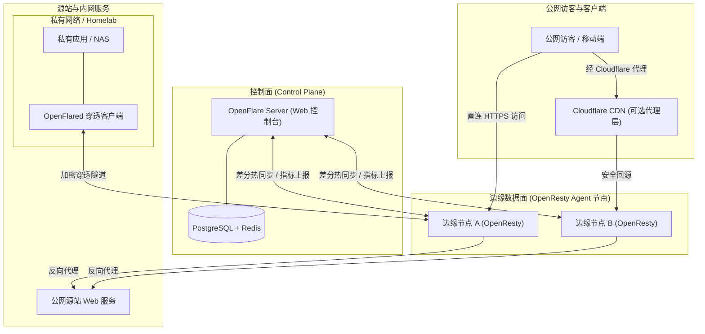

## 📖 核心理念：超越传统 Nginx 单机运维

在传统的多服务器架构中，管理 Nginx 往往面临如下痛点：
1. **多节点难以协同**：每台机器需要手动编写 `nginx.conf`，证书分散，容易产生配置漂移；
2. **Reload 容易产生连接抖动**：每次更新域名或上游必须执行 `nginx -s reload`；
3. **缺乏开箱即用的高阶防御**：单机 Nginx 仅有基础的 `limit_req` 频率限制，面对分布式 CC 攻击和爬虫往往无能为力。

**OpenFlare 将 OpenResty 升级为具备云端调度能力的高可用边缘网络**。控制面统一下发配置，数据面通过 Lua 共享内存实现差分热更新，并内置类似 Turnstile 的客户端 PoW 人机验证，在网络边缘秒级阻断恶意流量。

---

## 🌐 双重部署模式

::: tip 模式一：独立自建模式 (Standalone Edge Gateway)
适用于拥有多台独立 VPS、跨地域云服务器或 Homelab 的开发者。完全自主掌控流量与数据，自建属于自己的高可用分发与安全防御网络。
:::

::: info 模式二：Cloudflare 源站护盾模式 (Behind Cloudflare / Origin Shield)
作为 Cloudflare 背后的源站集群网关：
- **防范源站真实 IP 泄露**：攻击者即使绕过 Cloudflare 直连源站真实 IP，OpenFlare 边缘的 WAF 与 PoW 人机验证依然能够就地拦截；
- **全量私有访问日志留存**：弥补商业 CDN 免费版日志保留极短、明细不足的痛点；
- **多后端统一动态路由**：承接 Cloudflare 流量并动态分发至内网服务或不同源站。
:::

---

## 📊 横向对比

| 维度 | 传统 Nginx (`nginx.conf`) | Nginx Proxy Manager (NPM) | **OpenFlare** |
| :--- | :--- | :--- | :--- |
| **集群架构** | 每台机器独立维护，频繁 SSH | 仅支持单机，无法多节点集群协同 | **原生分布式控制面 + 边缘 Agent 集群** |
| **配置生效方式** | 每次需 `nginx -s reload`，连接可能抖动 | 频繁 Reload | **共享内存/差分热同步，Zero-Reload** |
| **防 CC / 爬虫人机验证** | 仅支持简单的 `limit_req` 频率限制 | 不支持 | **内置类似 Turnstile 的 PoW 客户端挑战** |
| **内网穿透 (Tunnels)** | 需繁琐集成第三方程式 (如 frp) | 不支持 | **内置 OpenFlared 穿透隧道，开箱即用** |
| **WAF 与安全防护** | 需复杂编译配置 ModSecurity | 仅基础 Exploits 规则 | **动态 WAF、国家级 GeoIP、IP 组差分准入** |
| **静态 Pages 托管** | 手动上传并配置静态目录 | 仅静态文件代理 | **自动化拉取 GitHub Release，版本回滚** |
| **配合 Cloudflare** | 手动配置 `set_real_ip_from` 极其繁琐 | 需繁琐设置代理头部 | **原生还原真实 IP，完美充当源站护盾** |

---

## 🏗️ 架构拓扑

---

## ⚖️ 商标免责声明 (Trademark Disclaimer)

OpenFlare is an independent, community-driven open-source project. It is not affiliated with, endorsed by, or sponsored by Cloudflare, Inc. Cloudflare and related trademarks are the property of their respective owners.

OpenFlare 是一个由社区驱动的独立开源项目，与 Cloudflare, Inc. 无任何附属、认可或赞助关系。Cloudflare 及其相关商标均为其各自持有者的财产。

